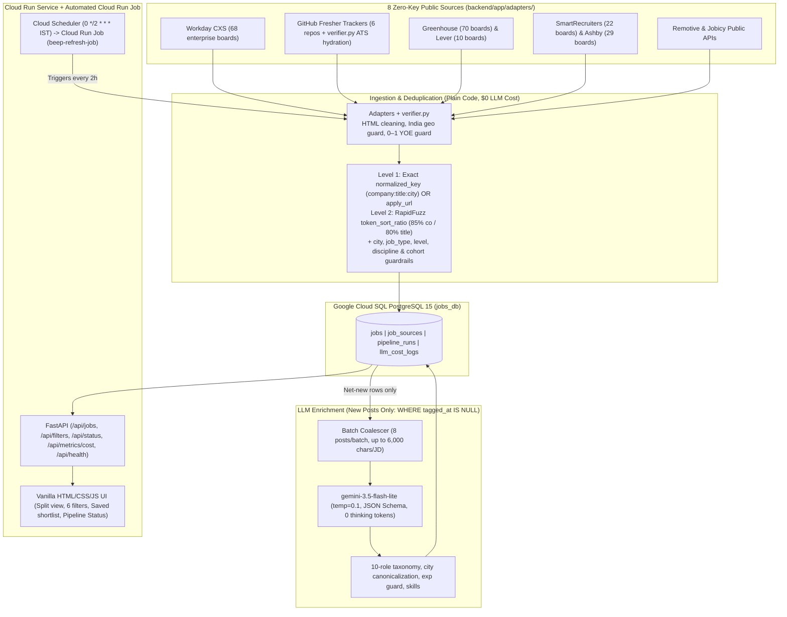

# Beep Job Hub — Live Fresher Job Aggregator & AI Enrichment Engine

> **Live fresher & internship job discovery engine tailored for Indian college students and early-career graduates (0–1 years exp), built for the Beep Gen AI & Engineering assessment.**

- **Live App:** https://beep-job-hub-524515781472.asia-south1.run.app/
- **Repository:** https://github.com/Aditya290605/Beep-Job-Search

[](#)
[](#)
[](#)
[](#)
[](#)

---

## 1. System Architecture



---

## 2. Live Production Metrics (Verified 20 Nov 2026)

| Metric | Live Production Value | Source / Verification |
| :--- | :---: | :--- |
| **Active Live Jobs** | **237** | `GET /api/jobs` on Cloud Run (`asia-south1`) |
| **Unique Companies** | **87** | NVIDIA, Intel, Citi, Deutsche Bank, Stripe, Rubrik, Microsoft, Google, Paytm, Cisco, etc. |
| **Unique Apply URLs** | **237 / 237 (100%)** | 15/15 random sample deep-verified OPEN via ATS APIs |
| **Unattended Scheduled Runs** | **7 consecutive green runs** | Every 2 hours (`:30 UTC` / `:00 IST`), `0` failures in Runs #6–#12 |
| **LLM Model** | `gemini-3.5-flash-lite` | Structured JSON schema, `temperature=0.1`, `0` thinking tokens |
| **True Cost / 1,000 Posts** | **\$0.61 / 1k** *(post-fix)* | Official `\$0.30/1M` in, `\$2.50/1M` out (see `COST_REPORT.md`) |
| **Monthly GCP + LLM Cost** | **~\$11 / month** | ~\$10.20 Cloud SQL `db-f1-micro` + <\$1 LLM; Cloud Run/Scheduler in free tier |
| **API Latency (Warm)** | **99ms median / 411ms p95** | Measured via live `X-Process-Time` across 15 filtered queries |

---

## 3. Quick Start (Local Setup)

```bash
# 1. Clone repository
git clone https://github.com/Aditya290605/Beep-Job-Search.git
cd Beep-Job-Search

# 2. Copy environment configuration
cp .env.example .env
# Optional: set GEMINI_API_KEY in .env if re-running live LLM tagging

# 3. Launch full-stack local server (auto-seeds local SQLite from backend/app/seed_jobs.json)
AUTO_SEED_ON_BOOT=true PYTHONPATH=backend python3 -m uvicorn app.api.main:app --host 0.0.0.0 --port 8080 --reload
```

Open **`http://localhost:8080`** in your browser.

### Run Unit Tests
```bash
python3 -m unittest discover -v backend/tests
node -c frontend/assets/app.js
```

### Run Ingestion & Tagging Manually
```bash
PYTHONPATH=backend python3 -m app.pipeline
```

---

## 4. Deduplication & LLM Tagging Design

- **Deduplication (`backend/app/dedupe.py` + `backend/app/db.py`):** 100% deterministic code + `RapidFuzz` (`$0` LLM spend).
  1. **Level 1:** Exact match on `normalized_key` (`alnum(company):alnum(title):alnum(city)`) OR exact `apply_url`.
  2. **Level 2:** City-bucketed `rapidfuzz.fuzz.token_sort_ratio` (`company >= 85%`, `title >= 80%`) after corporate noise stripping, brand alias mapping (`Hewlett Packard Enterprise -> hpe`), and tech acronym expansion.
  3. **Hard Guardrails:** Never merges across different cities, job types (`job` vs `internship`), seniority numerals (`I` vs `II`), mutually exclusive discipline tracks (`Software` vs `Silicon/Hardware`, `Frontend` vs `Backend`), or cohort years (`2024` vs `2027`). All duplicate source links are preserved in `job_sources`.
- **LLM Tagging (`backend/app/tagger.py`):** Runs **only on net-new posts** (`WHERE tagged_at IS NULL AND is_active = TRUE`). Classifies into 10 canonical roles (`SDE`, `Data/ML`, `Hardware`, `Design`, `Marketing`, `Sales`, `Ops`, `Finance`, `HR`, `Other`), normalizes Indian cities, rejects 2+ year roles (digits and spelled-out words), and extracts concrete skills directly from up to 6,000 chars of the JD.

---

## 5. CI/CD & GCP Production Deployment

- **Automated CI/CD:** [`.github/workflows/deploy.yml`](file:///Users/adityamagar/Beep-Job-Search/.github/workflows/deploy.yml) runs unit tests + JS syntax check on every push to `main`, builds and pushes the Docker image to Artifact Registry, updates both **Cloud Run Service (`beep-job-hub`)** and **Cloud Run Job (`beep-refresh-job`)**, and runs a live `/api/health` smoke check.
- **Full GCP setup & shutdown guide:** [`DEPLOY.md`](file:///Users/adityamagar/Beep-Job-Search/DEPLOY.md).

---

## 6. Key Documentation & Submission Deliverables

- [`SUBMISSION.md`](file:///Users/adityamagar/Beep-Job-Search/SUBMISSION.md) — Complete master submission report (Architecture, Sources, Prompts, Costs, Accuracy, Incident Post-Mortems)
- [`submission/COST_REPORT.md`](file:///Users/adityamagar/Beep-Job-Search/submission/COST_REPORT.md) — Live token telemetry, official Google pricing, and cost per 1k & monthly GCP run cost
- [`submission/SOURCES.md`](file:///Users/adityamagar/Beep-Job-Search/submission/SOURCES.md) — All 8 active data sources, live counts, endpoints, and legal/ToS assessment
- [`submission/PROMPTS.md`](file:///Users/adityamagar/Beep-Job-Search/submission/PROMPTS.md) / [`prompts.csv`](file:///Users/adityamagar/Beep-Job-Search/submission/prompts.csv) — In-app system prompt, JSON schema, and AI workflow prompts
- [`submission/LOOM_SCRIPT_5MIN.md`](file:///Users/adityamagar/Beep-Job-Search/submission/LOOM_SCRIPT_5MIN.md) — 5-minute video walkthrough script
- [`submission/accuracy_sample_50.csv`](file:///Users/adityamagar/Beep-Job-Search/submission/accuracy_sample_50.csv) — 50-post hand-checked evaluation dataset (98% accuracy)
- [`submission/eval_accuracy.py`](file:///Users/adityamagar/Beep-Job-Search/submission/eval_accuracy.py) — Accuracy evaluation script with Wilson 95% confidence intervals
